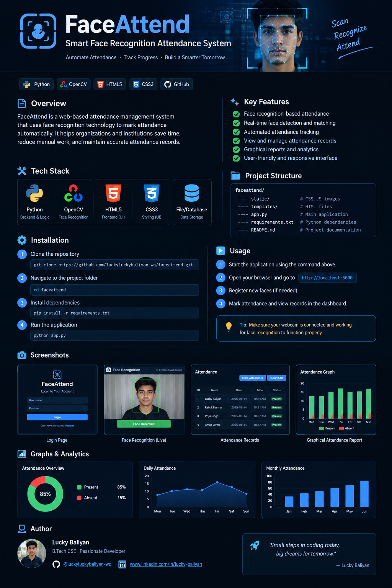
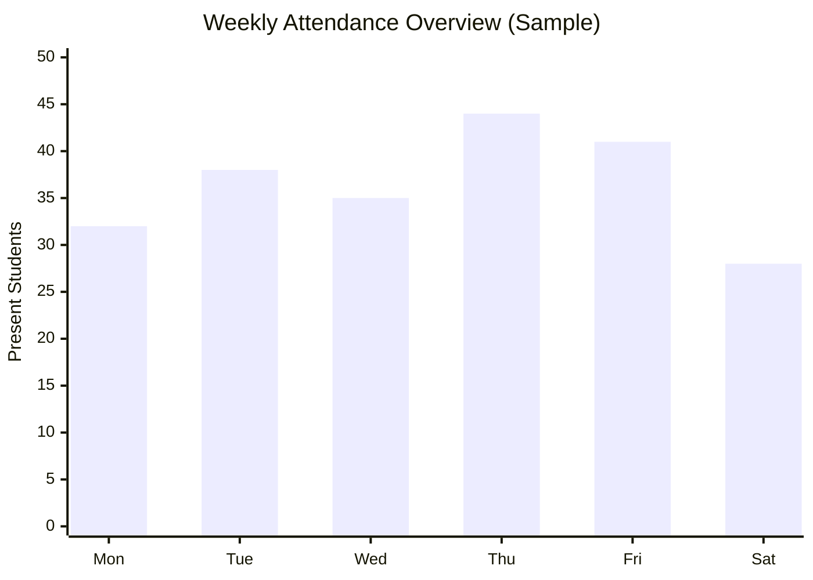
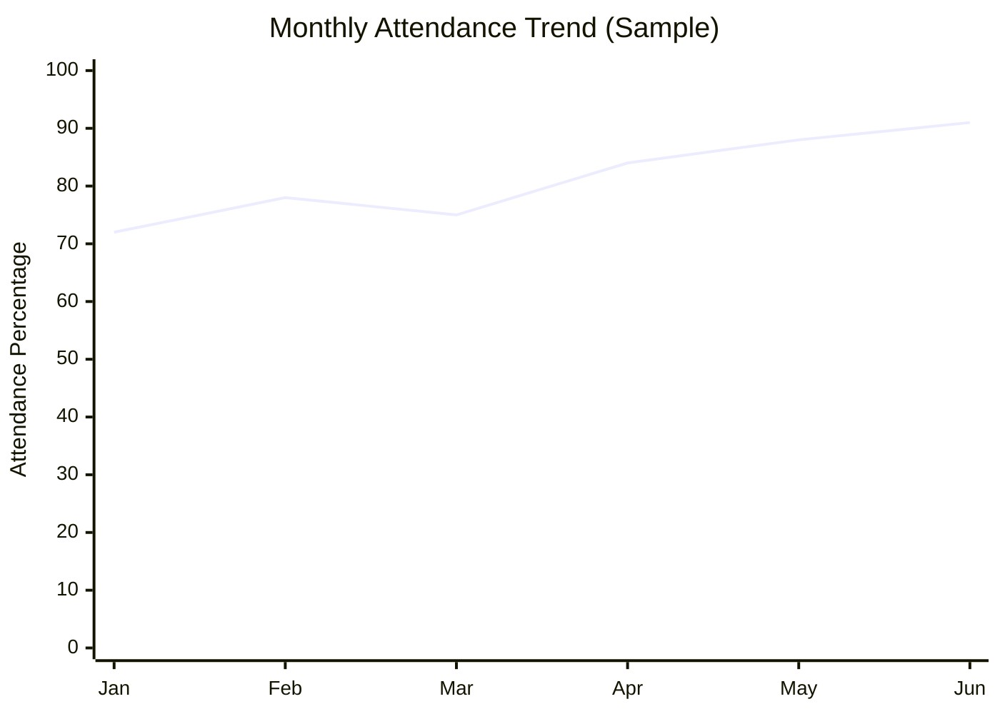

<p align="center">
  
</p.

# 🎯 FaceAttend — Smart Face Recognition Attendance System

<p align="center">
  <b>Automate Attendance • Recognize Faces • Track Progress</b>
</p>

<p align="center">
  
  
  
  
</p>

<p align="center">
  A face recognition-based attendance management project designed to simplify attendance tracking and record management.
</p>

---

## 📌 Table of Contents

- [Overview](#-overview)
- [Features](#-features)
- [Project Screenshots](#-project-screenshots)
- [Technology Stack](#-technology-stack)
- [Project Structure](#-project-structure)
- [Installation](#-installation-and-setup)
- [How to Run](#-how-to-run)
- [Attendance Analytics](#-attendance-analytics)
- [Future Improvements](#-future-improvements)
- [Author](#-author)

---

## 🚀 Overview

**FaceAttend** is a Python-based attendance management project that aims to make attendance recording faster and more convenient through face recognition.

The project can be extended to help educational institutions, teams, and organizations manage attendance records digitally.

### 🎯 Project Goals

- Reduce manual attendance entry.
- Explore face detection and recognition.
- Organize attendance records.
- Present attendance information in a clear format.
- Build practical skills in Python development.

## ✨ Features

| Feature | Description |
|---|---|
| 👤 Face Recognition | Identify faces using the recognition method implemented in the project. |
| 📸 Camera Integration | Capture camera input if supported by the application. |
| 📅 Attendance Records | Maintain attendance data. |
| 📊 Attendance Analytics | Visualize attendance data with graphs. |
| 🗂️ Record Management | Organize project data and attendance records. |
| 🖥️ Web Interface | Access the application through a web interface, if configured. |

> Note: The available features depend on your actual implementation. Update this list to match your application.

## 🖼️ Project Screenshots

Add screenshots of your actual application to the `assets` folder and use the paths below.

### 🔐 Application Interface

<p align="center">
  
</p>

### 📸 Face Recognition

<p align="center">
  
</p>

### 📋 Attendance Records

<p align="center">
  
</p>

### 📊 Attendance Dashboard

<p align="center">
  
</p>

---

## 🛠️ Technology Stack

<p align="center">
  
</p>

| Technology | Purpose |
|---|---|
| Python | Application logic |
| OpenCV | Image processing and face detection, if used |
| Flask | Web server, if used |
| HTML5 | Web page structure |
| CSS3 | Styling and layout |
| JavaScript | Interactive features, if used |
| Git and GitHub | Version control and project hosting |

## 📂 Project Structure

```text
faceattend/
│
├── FaceAttend/          # Project code or additional resources
├── static/              # Static assets, CSS, JavaScript, and images
├── assets/              # README banner and screenshots
│   ├── faceattend-banner.png
│   ├── home.png
│   ├── face-recognition.png
│   ├── attendance-records.png
│   └── attendance-dashboard.png
│
├── app.py               # Main Python application
├── requirements.txt     # Python dependencies
└── README.md            # Project documentation
```

Adjust this tree to match your actual files and folders.

## ⚙️ Installation and Setup

### 1. Clone the repository

```bash
git clone https://github.com/luckyluckybaliyan-wq/faceattend.git
```

### 2. Enter the project directory

```bash
cd faceattend
```

### 3. Create a virtual environment (recommended)

```bash
python -m venv venv
```

Activate it on Windows PowerShell:

```powershell
.\venv\Scripts\Activate.ps1
```

### 4. Install dependencies

```bash
pip install -r requirements.txt
```

### 5. Run the application

```bash
python app.py
```

If the application uses Flask, open the local URL printed in your terminal, commonly `http://127.0.0.1:5000`.

## 📊 Attendance Analytics

The following charts demonstrate how attendance data can be visualized. **The numbers below are illustrative sample data, not actual attendance records from FaceAttend.**

### Weekly Attendance



### Monthly Attendance Trend



### Attendance Summary

| Metric | Sample Value |
|---|---:|
| Total registered students | 50 |
| Present | 42 |
| Absent | 8 |
| Attendance rate | 84% |

The sample rate is calculated as:

`Attendance Rate = (Present / Total Students) × 100`

For the sample values above:

`(42 / 50) × 100 = 84%`

Replace these sample numbers with actual attendance data before using the charts in a real report.

## 🔮 Future Improvements

- [ ] Live attendance dashboard.
- [ ] Export attendance records to CSV or Excel.
- [ ] Date-wise and monthly attendance reports.
- [ ] Student registration and face enrollment.
- [ ] Search and filter attendance records.
- [ ] Authentication and access control.
- [ ] Improved error handling and recognition accuracy.
- [ ] Responsive interface for mobile devices.

## 👨‍💻 Author

<p align="center">
  <b>Lucky Baliyan</b><br>
  Computer Science Student | Aspiring Software Developer
</p>

<p align="center">
  <a href="https://github.com/luckyluckybaliyan-wq">
    
  </a>
  <a href="https://www.linkedin.com/">
    
  </a>
</p>

---

## ⭐ Support

If you find this project interesting, consider giving the repository a star!

<p align="center">
  <b>“Small steps in coding today, big dreams for tomorrow.”</b>
</p>

<p align="center">
  Made with ❤️ by Lucky Baliyan
</p>
